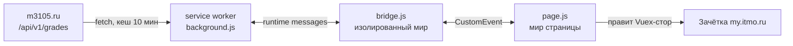

<div align="center">

# 📊 Зачётка + баллы из таблиц

**Расширение для Chrome, которое дописывает в «Зачётку» на [my.itmo.ru](https://my.itmo.ru/points)
реальные баллы из таблиц преподавателей**


</div>

---

В ИСУ баллы появляются с опозданием: лабы давно сданы, тесты написаны, а в зачётке пусто.
У преподавателей всё уже есть в Google-таблицах, и [m3105.ru/grades](https://m3105.ru/grades)
собирает их в одном месте. Расширение приносит эти баллы прямо в зачётку, в привычный
интерфейс.

## ✨ Что появляется в зачётке

| | |
| --- | --- |
| 🟢 **Баллы в кружке** | Если в ИСУ пусто или меньше, чем в таблице, показываются баллы из таблицы. |
| 🏷️ **Плашка у предмета** | `из таблицы · в ИСУ 13`: видно, откуда число и сколько стоит в ИСУ. Клик открывает таблицу. |
| 🗂️ **Разбивка в раскрывашке** | Строка «Таблица преподавателя» с итогом, под ней лабы, тесты, ДЗ, коллоквиумы. |
| 🧪 **Детали по лабам** | Плюсики, просрочка и «принята, после теормина ≈ 14,88». |

```
Основы программирования  [из таблицы]   Экзамен    ◔ 26.4
├─ Экзамен                                0 - 30
├─ …официальные строки ИСУ…
└─ Таблица преподавателя (m3105.ru)       0 - 100   26.4   25.11.2026
   │ Лаба 1 (+0,96 плюсики)               0 - 12    12.96
   │ Лаба 2 (+1,44 плюсики)               0 - 12    13.44
   │ Лаба 3 — принята, после теормина ≈ 14,88
```

Баллы добавляются только в **текущий семестр**, прошлые не трогаются. Официальные данные
нигде не меняются: всё происходит только у вас во вкладке.

## 🚀 Установка

1. Скачайте репозиторий: `git clone https://github.com/kewldan/itmo-ext` или **Code → Download ZIP**.
2. Откройте `chrome://extensions` и включите **«Режим разработчика»**.
3. Нажмите **«Загрузить распакованное расширение»** и выберите папку проекта.
4. Откройте [my.itmo.ru/points](https://my.itmo.ru/points).

Работает в Chrome, Edge, Яндекс Браузере, Arc и других браузерах на Chromium.

## ⚙️ Настройки

Кнопка расширения на панели открывает попап:

- **вкл/выкл**: зачётка сразу возвращается к официальным данным;
- **какие баллы показывать**: большее из ИСУ и таблицы (по умолчанию) или всегда из таблицы;
- **ручная привязка**: фамилия, имя и группа, если в таблице вы записаны иначе или есть тёзки;
- **список найденных предметов** с суммами и кнопка «Обновить».

## 🔍 Как находится ваша строка

Фамилия и имя берутся из профиля my.itmo.ru и ищутся во всех таблицах m3105.ru. Если вы
вошли на m3105.ru через Telegram и привязали ИСУ, сайт сам помечает вашу строку, и имя
не нужно. Баллы кешируются на 10 минут.

## 🔒 Приватность

- На m3105.ru уходят только обычные `GET`-запросы к публичному API баллов.
- Имя из my.itmo.ru хранится локально в браузере и никуда не отправляется: строка ищется
  у вас на компьютере.
- Ни аналитики, ни сторонних серверов.

## 🛠 Как это устроено



«Зачётка» — приложение на Nuxt 2. Список предметов приходит из
`/api/record_book/{план}/{семестр}`, детали — из `/api/record_book/{est_id}`, и всё
складывается во Vuex-модуль `modules/points/points`. `page.js` подписывается на его мутации
и сразу после `SET_DISCIPLINES` и `SET_DETAILS` дописывает баллы из таблиц. Отрисовывает
их сама зачётка, поэтому всё выглядит родным, в том числе на телефоне.

| Файл | Что делает |
| --- | --- |
| [`src/background.js`](src/background.js) | загружает все таблицы, кеширует их, ищет вашу строку |
| [`src/bridge.js`](src/bridge.js) | связывает страницу и фон |
| [`src/page.js`](src/page.js) | дописывает баллы в стор зачётки и добавляет плашки |
| [`popup/`](popup) | настройки |
| [`test/harness.html`](test/harness.html) | макет стора для проверки без входа в ИСУ |

## 🧑‍💻 Разработка

Сборки нет: правите файлы и нажимаете ↻ у расширения в `chrome://extensions`.

Проверить `page.js` без входа в ИСУ можно на макете:

```bash
python3 -m http.server 8765
```

Откройте <http://localhost:8765/test/harness.html>. Там лежит макет стора с тем же модулем
и обезличенные баллы из `test/fixture.json`.

## 📄 Лицензия

[MIT](LICENSE)
